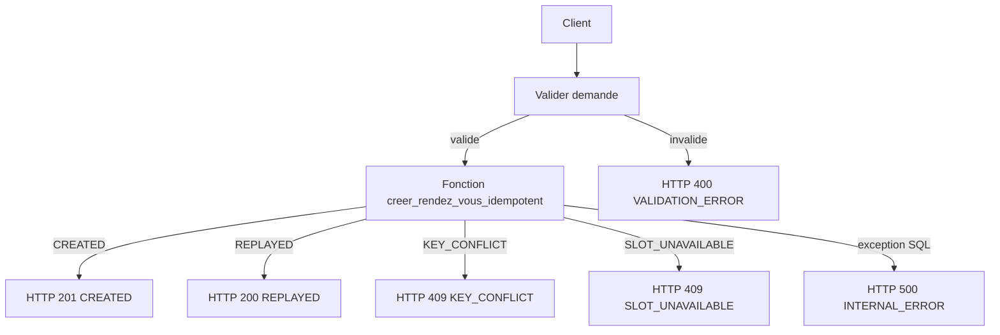

# Rapport REC-007 — phase 7D, conception de l'idempotence

**Date :** 29 octobre 2026  
**Périmètre :** concevoir l'idempotence de `03_API_CreateAppointment`, sans la déployer.  
**Verdict :** **GO** pour préparer l'implémentation dans une phase ultérieure. **NO-GO** pour appliquer la migration ou publier le workflow maintenant.

## 1. État vérifié

Lecture seule. Aucune migration, aucun appel d'écriture, aucun rendez-vous créé.

| Élément | Valeur constatée |
|---|---|
| PostgreSQL | 16.14, isolation `read committed` |
| Extension | `pgcrypto` installée |
| n8n | 2.32.6, workflow 03 actif |
| Version | `c48ffad5-4f36-4c7e-9abf-11ce6fa2d9e6`, 11 nœuds |
| Workflows 08 et 10 | inactifs |
| Rendez-vous | 13, empreinte `a2dea067599fd4f0a5f857551adc67cc` |
| Notifications | 14 |
| Historique | 12 |
| Sessions | 48 |

`rendez_vous` n'a pas de colonne d'idempotence. Ses unicités actuelles sont `id`, `reference` et `token_gestion`. Les 13 lignes existantes restent valides si les nouvelles colonnes sont nullables. `notifications` a déjà `UNIQUE(rendez_vous_id, type, canal)`. `historique_rendez_vous` et `notifications` partent en cascade si le rendez-vous est supprimé. Les statuts prévus sont `EN_ATTENTE`, `CONFIRME`, `ANNULE`, `REPLANIFIE`, `PRESENT`, `ABSENT`, `TERMINE`.

## 2. Recommandation d'architecture

Retenir l'option A : deux colonnes sur `rendez_vous`, un index unique partiel, et une fonction PL/pgSQL qui traite la course dans une sous-transaction.

L'option B, une table dédiée, sépare la rétention de la clé de la vie du rendez-vous. Elle n'apporte rien tant que l'annulation et la replanification conservent la même ligne, ce que le schéma permet déjà par le statut. Elle ajouterait une seconde écriture à maintenir atomique et une décision de clé étrangère. Elle redevient préférable seulement si une expiration des clés doit survivre à la suppression physique des rendez-vous. Ce n'est pas le besoin de cette version.

Un `SELECT` suivi d'un `INSERT` dans n8n ne suffit pas. Sous `read committed`, deux transactions peuvent ne voir aucune ligne, puis insérer toutes les deux. L'index unique est le verrou réel. La fonction rattrape la perdante après `unique_violation`, une fois sa sous-transaction annulée, et relit le rendez-vous gagnant.



## 3. Contrat API

Un seul mécanisme. Le corps `cleIdempotence` et l'en-tête `Idempotency-Key` sont deux alias de la même valeur, pas deux réserves distinctes.

| Entrée | Effet |
|---|---|
| Ni corps ni en-tête, ou chaîne vide après trim | Comportement actuel, non idempotent |
| Un seul des deux est présent | Cette valeur est la clé |
| Les deux sont présents et identiques après trim | Cette valeur est la clé |
| Les deux diffèrent | HTTP 400, aucune écriture |

Règles de la clé, après trim :

- Longueur de 16 à 128 caractères.
- Alphabet `A-Za-z0-9._~-`.
- Sensible à la casse. Aucune mise en minuscules.
- L'exemple `req-123` est trop court et doit être refusé. Une valeur valide est un UUID v4 ou 128 bits tirés d'un générateur cryptographique.
- La valeur reçue n'est pas recopiée dans le message d'erreur.

Empreinte de contenu, calculée dans la fonction, en JSON canonique UTF-8 puis SHA-256 :

- `slotId` en UUID canonique minuscule ;
- `nom` et `prenom` trimés et normalisés Unicode NFC ;
- `email` trimé, vidé devenu nul, sinon en minuscules ;
- `telephone` et `numeroDocument` trimés, vide devenu nul ;
- `langue` trimée, défaut `fr`.

La clé elle-même n'entre pas dans l'empreinte. L'adresse stockée conserve la casse du premier appel. L'empreinte, elle, compare les adresses sans tenir compte de la casse.

| Situation | HTTP | Corps |
|---|---|---|
| Première clé, créneau réservable | 201 | `success: true`, `created: true`, `replayed: false`, objet `appointment` identique au contrat actuel |
| Même clé, même empreinte | 200 | même objet `appointment`, `created: false`, `replayed: true` |
| Même clé, empreinte différente | 409 | `error.code = IDEMPOTENCY_KEY_CONFLICT`. Aucun identifiant, aucune référence, aucun jeton |
| Clé absente | 201 ou 409 métier | contrat actuel, non idempotent |
| Clé mal formée, ou alias divergents | 400 | `VALIDATION_ERROR` |
| Créneau inconnu, complet ou passé, clé encore inconnue | 409 | message actuel « Créneau introuvable ou complet » |
| Erreur SQL | 500 | message fixe `INTERNAL_ERROR`, sans SQL |

Le HTTP 201 actuel reste lisible par les clients qui ignorent `created` et `replayed`. Le HTTP 409 de clé se distingue du HTTP 409 de créneau par la présence de `error.code`.

## 4. PostgreSQL

La migration suivante n'est pas exécutée.

```sql
ALTER TABLE rendez_vous
  ADD COLUMN cle_idempotence varchar(64),
  ADD COLUMN empreinte_requete char(64);

ALTER TABLE rendez_vous
  ADD CONSTRAINT ck_rendez_vous_idempotence
  CHECK (
    (cle_idempotence IS NULL AND empreinte_requete IS NULL)
    OR (
      cle_idempotence IS NOT NULL
      AND empreinte_requete IS NOT NULL
      AND cle_idempotence ~ '^[0-9a-f]{64}$'
      AND empreinte_requete ~ '^[0-9a-f]{64}$'
    )
  );

CREATE UNIQUE INDEX uq_rendez_vous_cle_idempotence
  ON rendez_vous (cle_idempotence)
  WHERE cle_idempotence IS NOT NULL;
```

`cle_idempotence` contient le SHA-256 hexadécimal de la clé brute, calculé par `encode(digest(convert_to(cle, 'UTF8'), 'sha256'), 'hex')`. La clé brute ne reste pas en base. Les 13 lignes actuelles ont les deux colonnes nulles et ne sont pas dans l'index.

`SELECT ... WHERE cle_idempotence = hash FOR UPDATE` ne verrouille pas l'absence de ligne. Deux transactions peuvent donc passer ensemble. L'index unique fait échouer la seconde insertion. La fonction fait ceci :

1. Si la clé est nulle, suivre le chemin actuel : verrou du créneau, insertion, place, historique, notification conditionnelle, résultat `CREATED` ou `SLOT_UNAVAILABLE`.
2. Si la clé est présente, lire la ligne existante `FOR UPDATE`.
3. Ligne trouvée et empreinte identique : `REPLAYED`, sans nouvelle place, sans historique, sans notification.
4. Ligne trouvée et empreinte différente : `KEY_CONFLICT`, sans donnée du rendez-vous.
5. Ligne absente : ouvrir une sous-transaction, verrouiller le créneau futur et libre, insérer le rendez-vous avec la clé et l'empreinte, incrémenter la place, écrire `CREATION`, insérer la notification seulement si l'adresse n'est pas nulle, résultat `CREATED`.
6. Si l'insertion lève `unique_violation`, annuler seulement la sous-transaction, relire le gagnant, puis répondre `REPLAYED` ou `KEY_CONFLICT`.
7. Toute autre erreur annule l'instruction. n8n répond HTTP 500. Aucune place n'est conservée.

Le chemin `REPLAYED` ne réévalue pas `debut > now()` ni la capacité. Un créneau devenu complet ou passé après le premier succès reste rejouable. Une première demande refusée ne consomme pas la clé : un appel ultérieur, quand le créneau redevient réservable, peut encore créer.

Annulation et replanification changent le statut de la même ligne. La clé reste attachée. Un replay renvoie l'état courant, y compris `ANNULE` ou `REPLANIFIE`, et ne crée pas un second rendez-vous. Une nouvelle réservation après annulation exige une nouvelle clé.

Une suppression physique libère la clé, parce que l'index disparaît avec la ligne. Les nettoyages de test continuent de supprimer la ligne synthétique. En production, l'annulation doit passer par le statut, pas par `DELETE`. Cette version n'expire pas les clés. Une expiration indépendante du rendez-vous justifierait alors l'option B.

Rollback SQL, à n'exécuter qu'après le retour du workflow à `c48ffad5-4f36-4c7e-9abf-11ce6fa2d9e6`, et seulement si aucune clé de production ne doit être conservée :

```sql
DROP FUNCTION IF EXISTS creer_rendez_vous_idempotent(
  uuid, varchar, varchar, varchar, varchar, varchar, varchar, varchar
);
DROP INDEX IF EXISTS uq_rendez_vous_cle_idempotence;
ALTER TABLE rendez_vous DROP CONSTRAINT IF EXISTS ck_rendez_vous_idempotence;
ALTER TABLE rendez_vous DROP COLUMN IF EXISTS empreinte_requete;
ALTER TABLE rendez_vous DROP COLUMN IF EXISTS cle_idempotence;
```

La fonction est `SECURITY INVOKER`, avec un `search_path` fixé à `pg_catalog, public`. Son exécution est accordée au rôle de l'application et retirée à `PUBLIC`.

## 5. Workflow n8n proposé

Les 11 nœuds actuels restent la base. Le SQL de création devient l'appel à la fonction, toujours avec `$1` à `$8`, sans interpolation. `Conserver le résultat` et la sortie d'erreur vers HTTP 500 restent.

| Nœud | Changement |
|---|---|
| `Valider demande` | Lit l'alias corps/en-tête, refuse une clé mal formée ou deux alias divergents, transmet `null` si la clé est absente |
| `Demande valide ?` et `Répondre validation` | Inchangés, HTTP 400 |
| `Créer rendez-vous` | `SELECT * FROM creer_rendez_vous_idempotent(...)` |
| `Conserver le résultat` | Inchangé |
| `Vérifier création` et `If` | Remplacés par un nœud Switch sur `issue` |
| `Répondre` | HTTP 201, seulement `CREATED`. Le corps reprend les champs actuels de `appointment` |
| Nouveau `Répondre replay` | HTTP 200, seulement `REPLAYED`, mêmes champs d'appointment, dont le jeton |
| Nouveau `Répondre conflit idempotence` | HTTP 409 `IDEMPOTENCY_KEY_CONFLICT`, sans appointment |
| `Répondre créneau indisponible` | HTTP 409 métier, `SLOT_UNAVAILABLE` |
| `Répondre erreur interne` | HTTP 500 inchangé |

Le Switch a quatre sorties : `CREATED`, `REPLAYED`, `KEY_CONFLICT`, `SLOT_UNAVAILABLE`. Aucune de ces sorties n'écrit une seconde notification ou un second historique : ces écritures n'existent que dans la branche `CREATED` de la fonction.

Le graphe passe de 11 à 12 nœuds : le `If` sort, le Switch et deux répondeurs entrent, `Vérifier création` sort aussi parce que le Switch lit directement `issue`. Le décompte exact à publier plus tard est donc 11 - 2 + 3 = 12.

## 6. Cas difficiles

| Cas | Comportement retenu |
|---|---|
| Deux requêtes identiques simultanées | Une insertion gagne. L'autre reçoit `unique_violation`, annule sa place, relit le gagnant et répond HTTP 200 |
| Même clé, contenu différent | HTTP 409, sans révéler le premier rendez-vous |
| Réponse perdue après `COMMIT` | Le client renvoie la même clé et le même corps. HTTP 200, même jeton, aucune place supplémentaire |
| Rendez-vous ensuite annulé | HTTP 200, statut `ANNULE`. Pas de nouvelle création |
| Rendez-vous replanifié | HTTP 200, état courant de la même ligne. L'empreinte reste celle de la demande initiale |
| Création sans adresse | HTTP 201, adresse `NULL`, aucune notification. Le replay HTTP 200 n'en ajoute pas |
| Créneau devenu complet après le premier succès | Le replay répond 200. Une autre clé, ou une absence de clé, reçoit le HTTP 409 de créneau |
| Clé absente | Plusieurs créations restent possibles. C'est le contrat de compatibilité |
| Clé mal formée | HTTP 400 avant SQL. La clé n'est pas consommée |
| Redémarrage de n8n avant `COMMIT` | Rien n'est conservé. Le même appel peut créer |
| Redémarrage après `COMMIT` | Le replay retrouve la ligne |
| Erreur SQL | Instruction annulée, HTTP 500, clé non enregistrée |
| Suppression physique | La clé redevient libre. À réserver aux tests |
| Jeton au replay | Renvoyé seulement si la clé et l'empreinte correspondent |

Une clé devinée ne suffit pas à lire un rendez-vous : il faut aussi renvoyer le même contenu. Une clé volée avec un autre corps obtient un HTTP 409 muet. Le jeton n'est donc pas un secret indépendant de la demande. La protection repose sur une clé non devinable, stockée seulement sous forme de hash, et sur l'absence de détail dans le conflit.

Les exécutions n8n conserveront encore la clé brute dans le corps reçu. Ce n'est pas corrigé par le hash en base. Les journaux applicatifs ne doivent pas la recopier. Aucune authentification d'appelant n'existe aujourd'hui sur le webhook. Ajouter un secret d'appelant serait un autre contrat et casserait les clients actuels. Il ne fait pas partie de cette version. Le workflow 10, toujours inactif, devra plus tard générer une clé par confirmation, et réutiliser cette même clé s'il répète l'appel.

## 7. Matrice de tests

Aucun de ces tests n'est exécuté ici. Chaque création synthétique utilise une clé neuve, le créneau futur relu juste avant l'appel, puis le nettoyage ciblé déjà pratiqué. Conditions d'arrêt communes : un compteur inattendu, une seconde notification, une seconde ligne d'historique, une place non expliquée, ou un jeton dans un HTTP 409 de conflit. On ne réessaie pas un appel ambigu avant d'avoir lu la base et l'exécution.

| Test | Préconditions | Réponse | SQL attendu | Nettoyage |
|---|---|---|---|---|
| Première création | Clé neuve, créneau libre, adresse présente | HTTP 201 `CREATED` | 1 rendez-vous, 1 place, 1 `CREATION`, 1 notification `A_ENVOYER`, hash et empreinte remplis | Après le replay et le conflit |
| Replay | Même corps et même clé que la ligne précédente | HTTP 200 `REPLAYED`, même identifiant, même référence, même jeton | Aucune place, notification ou historique supplémentaire | Avec la ligne du premier appel |
| Conflit de clé | Même clé, nom différent | HTTP 409 `IDEMPOTENCY_KEY_CONFLICT`, sans appointment | La première ligne inchangée | Même nettoyage |
| Concurrence | Deux POST simultanés, même clé, même corps | Un HTTP 201 et un HTTP 200 | Une seule ligne, une place, une notification, un historique | Supprimer cette ligne |
| Clé absente | Deux corps identiques sans clé | Deux HTTP 201 | Deux rendez-vous | Supprimer les deux |
| Sans adresse | Clé neuve, `email` vide | HTTP 201, adresse `NULL` | Aucune notification, un historique, une place. Replay 200 sans notification nouvelle | Supprimer la ligne |
| Créneau complet | Capacité déjà atteinte, clé neuve | HTTP 409 métier | Aucune ligne pour cette clé | Aucun |
| Créneau passé | Créneau `DISPONIBLE` dont le début est passé | HTTP 409 métier | Clé non enregistrée. Un second appel identique reste 409 | Aucun |
| Erreur SQL | Fonction forcée à échouer dans une transaction de test annulée, hors webhook | Aucune ligne conservée après `ROLLBACK` | Places inchangées | La transaction de test annule déjà tout |
| Replay après complet | Premier succès, puis capacité saturée par ailleurs | HTTP 200 | La place du premier rendez-vous reste la seule liée à cette clé | Nettoyage du premier rendez-vous et recalcul des places |

Le test d'erreur SQL ne passe pas par le webhook : il appelle la fonction dans une transaction explicitement annulée, ou provoque une erreur de cast avant l'insertion. Il ne laisse pas de rendez-vous.

Le nettoyage d'une ligne créée avec une clé reprend la transaction déjà utilisée : verrou de la ligne et du créneau, contrôle de l'identité, suppression de cette seule ligne, recalcul des places, contrôle de l'empreinte des 13 rendez-vous initiaux, puis `COMMIT`. `ROLLBACK` si un contrôle échoue.

## 8. Risques

| Risque | Maîtrise |
|---|---|
| Course entre deux insertions | Index unique partiel et sous-transaction dans la fonction |
| Divulgation par une clé faible | Longueur minimale 16, alphabet fermé, hash en base, conflit sans contenu |
| Jeton renvoyé au replay | Réservé au détenteur de la clé et du même contenu. C'est le rattrapage d'une réponse perdue |
| Deux formes de HTTP 409 | Le conflit de clé porte `error.code`. Le créneau conserve son message actuel |
| Clients sans clé | Plusieurs créations restent possibles. Le contrat doit le dire |
| Clé libérée par `DELETE` | Acceptable pour les tests. L'annulation de production ne doit pas supprimer la ligne |
| Ancienne version du workflow après la migration | Elle ignore les colonnes nullables. Le déploiement migre d'abord, publie ensuite |
| Retrait des colonnes pendant que des clés existent | Interdit tant que le nouveau workflow est actif ou qu'une clé réelle doit survivre |

## 9. Plan de déploiement

À n'exécuter qu'après une autorisation distincte pour chaque palier.

1. Relire la version `c48ffad5-4f36-4c7e-9abf-11ce6fa2d9e6`, les 11 nœuds, les compteurs et l'empreinte.
2. Appliquer la migration additive et créer la fonction. Vérifier que les 13 rendez-vous et l'empreinte n'ont pas changé, et que l'ancien workflow répond encore sans clé.
3. Préparer le payload n8n à 12 nœuds, sans l'envoyer dans le même palier que la migration.
4. Publier le workflow. Vérifier qu'il reste actif et que les workflows 08 et 10 restent inactifs.
5. Exécuter la matrice sans écriture, puis les créations de la section 7, une à la fois, avec nettoyage.
6. En cas d'anomalie : republier `c48ffad5-4f36-4c7e-9abf-11ce6fa2d9e6`. Ne retirer les colonnes qu'ensuite, et seulement si aucune clé à conserver n'a été écrite. Ne pas republier `740ca2ae-87ea-4323-aa69-cfd57d869fc1`.

## 10. Verdict

**GO** pour préparer, dans une phase séparée, le fichier de migration et le payload du workflow décrits ici.

**NO-GO** pour les appliquer dans cette phase. La migration n'a pas été exécutée. Le workflow actif reste `c48ffad5-4f36-4c7e-9abf-11ce6fa2d9e6`. L'idempotence n'est pas en service. REC-008 n'est pas commencé.
